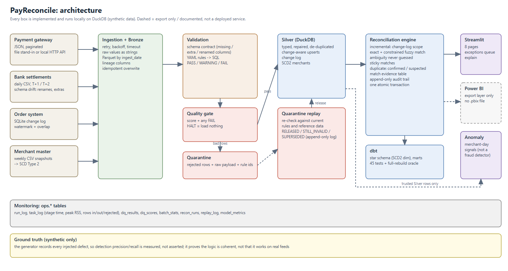
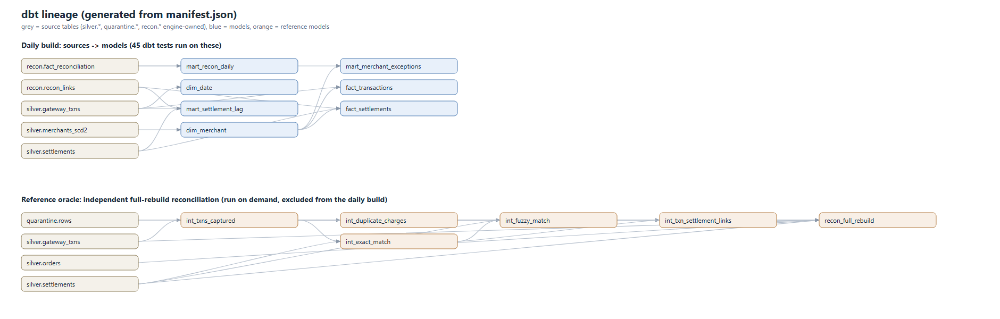
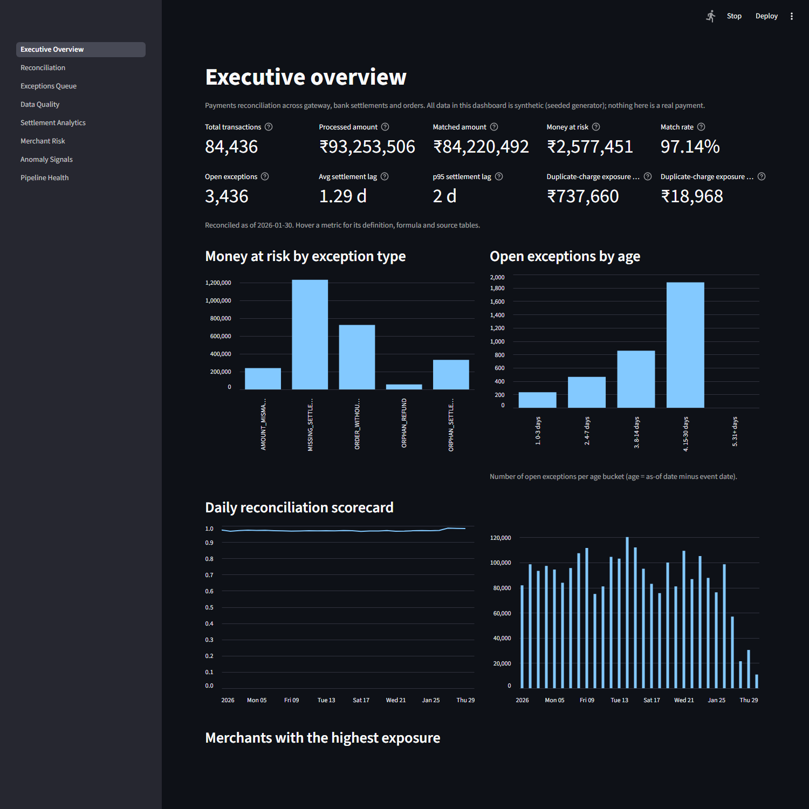
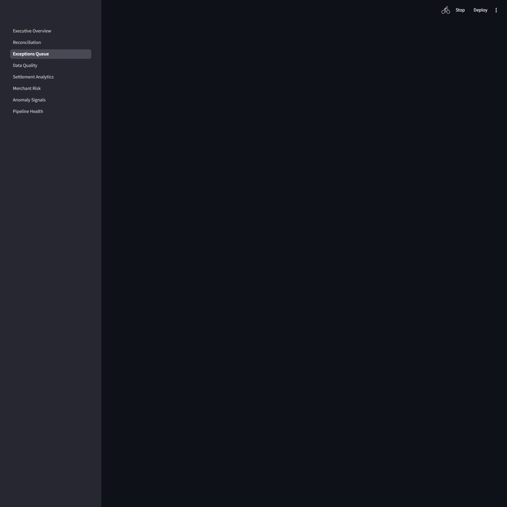
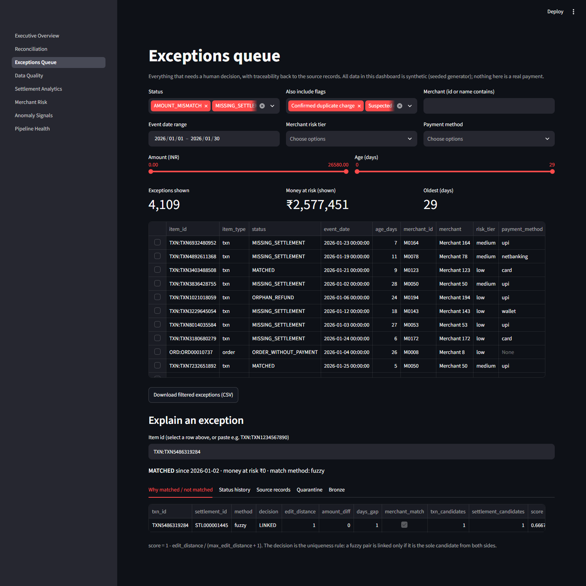
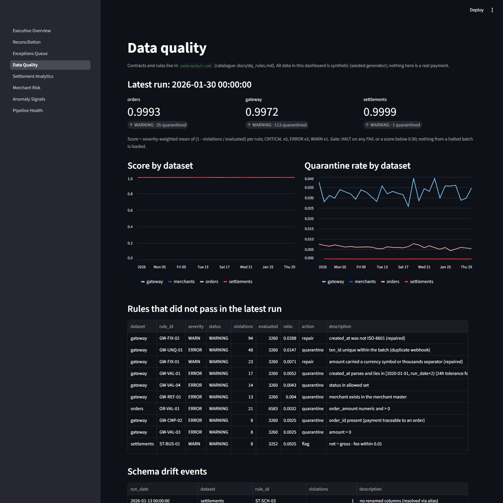
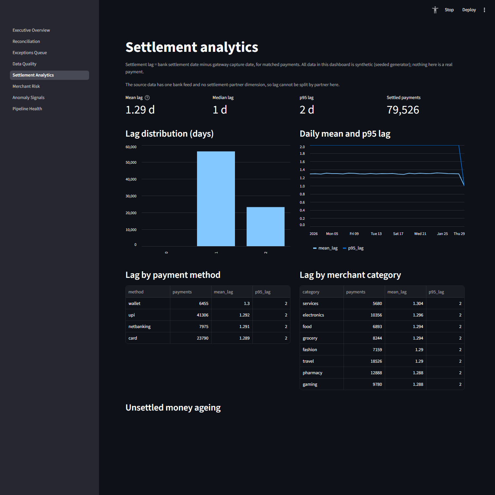
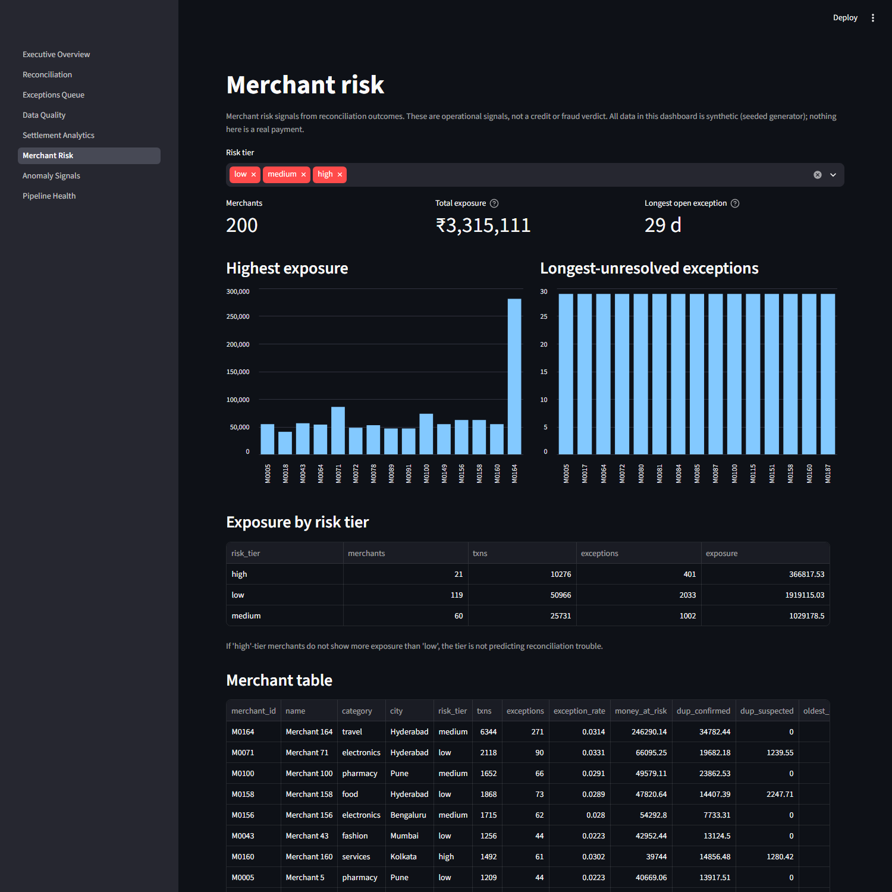
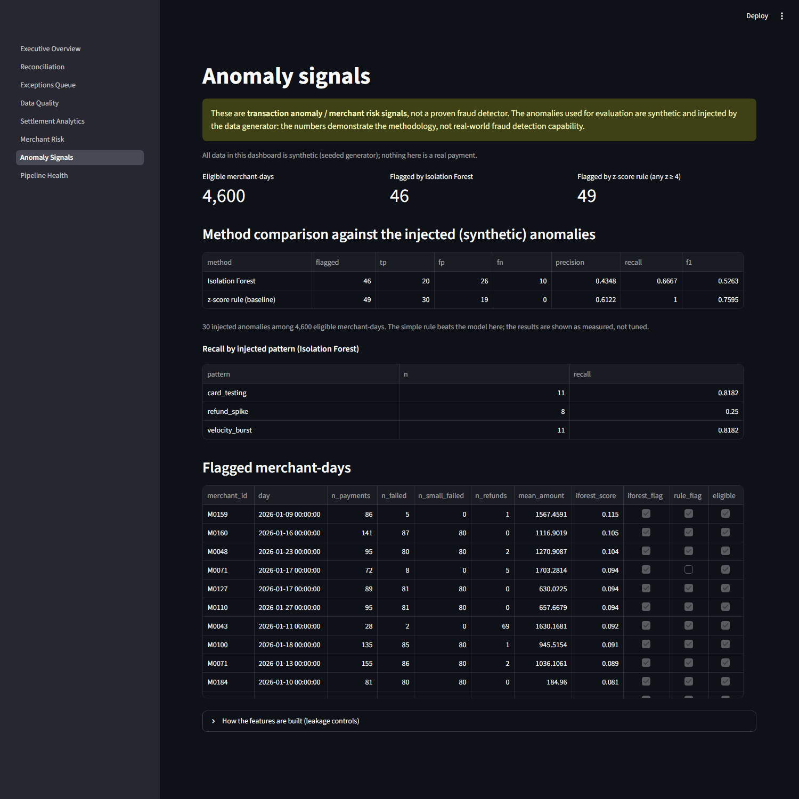
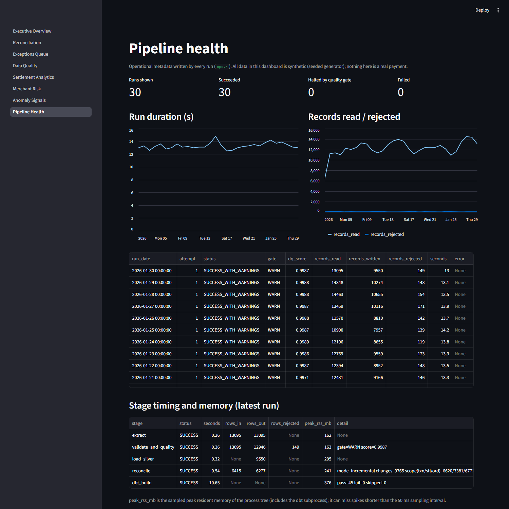

# PayReconcile

**A payments reconciliation and data-quality platform** that ingests messy gateway, bank and order data, quarantines bad records, reconciles the three money trails with an explainable, auditable, incremental engine, and reports **money at risk**.



## In 60 seconds

| | |
|---|---|
| **What is it?** | A local, lightweight data platform (Python, DuckDB, dbt, Streamlit) for a payments problem: a merchant is paid from three places that must agree (payment gateway, bank settlement, order system). They often do not, and every disagreement is money. |
| **Why does it matter?** | Reconciliation is a real finance-operations job in every payments company. The hard parts are the ones interviews probe: messy feeds, late data, false matches, explainability, idempotency and audit. |
| **What did I build?** | Ingestion (files + a local HTTP API with retry/backoff/timeout) -> Bronze Parquet -> YAML-driven data quality with quarantine and a quality gate -> Silver -> an **incremental reconciliation engine** (exact + constrained fuzzy matching, duplicate detection, sticky matches, per-match evidence, append-only audit) -> dbt star schema and tests -> an 8-page Streamlit dashboard with an explainable exceptions queue -> a Power BI-ready export -> merchant-day anomaly signals. |
| **What did I measure?** | Detection quality against a seeded answer key, incremental vs full recompute up to **8.6 M items**, a controlled **Silver-partitioning experiment** (it lost), per-stage time and memory on an 8 GB laptop, and a 139-test suite. All numbers below come from files in `docs/`. |

> **All data is synthetic** (seeded generator). Because the generator records what it injected, results are scored against a known answer key. That shows the logic is coherent and testable, **not** that it works on real feeds. See [Limitations](#15-limitations). **No component claims real fraud detection, production deployment or a finished Power BI report.**

## IMPLEMENTED vs DESIGNED BUT NOT IMPLEMENTED

| IMPLEMENTED (runs locally, tested) | DESIGNED BUT NOT IMPLEMENTED |
|---|---|
| Seeded messy-data generator with ground truth | Cloud deployment ([docs/cloud_design.md](docs/cloud_design.md)) |
| File source **and** local FastAPI gateway with pagination, retry, backoff, timeout | Streaming ingestion, Spark, Kafka, Airflow (deliberately not used) |
| Bronze Parquet, 50 documented quality rules, quarantine, quality gate | A date-bounded reconciliation engine (recommended next experiment, **not built or measured**) |
| Silver upserts (change-aware), SCD2 merchants | A settlement-partner dimension (the synthetic data has one bank feed) |
| Incremental reconciliation with evidence, audit, sticky links, atomic apply | PII handling, authentication, encryption |
| Quarantine replay with append-only log | Real-time alerting integrations |
| dbt star schema, marts, 45 tests, independent full-rebuild oracle | |
| 8-page Streamlit dashboard, `explain` command, exceptions filters | |
| Power BI **export layer + model documentation** | A `.pbix` report file (**not created**: Power BI Desktop is not available here; see [docs/powerbi.md](docs/powerbi.md)) |
| Merchant-day anomaly signals (Isolation Forest vs baseline) with leakage tests | Any claim of production-grade fraud detection |

## 1. Problem
The gateway says a payment was captured, the bank says money was settled, the order system says the order was paid. Real feeds disagree: a settlement never arrives, a customer is charged twice, a refund refers to a payment that does not exist, a bank reference has a typo, a file arrives with a renamed column, an API goes down, a feed silently switches from rupees to paise.

## 2. Business context
Finance operations need a work queue ("what money do I need to chase?"), an audit trail ("why is this item in this status, and since when?") and confidence that bad data cannot silently reach reports. The KPIs (money at risk, match rate, exception age, duplicate-charge exposure) are defined once in [docs/kpi_definitions.md](docs/kpi_definitions.md) with formula, business meaning and source tables.

## 3. Architecture
Design decisions and trade-offs: [docs/architecture.md](docs/architecture.md). Cloud mapping (**designed, not implemented**): [docs/cloud_design.md](docs/cloud_design.md).

```
gateway (JSON API / files) -+
bank settlements (CSV)      +-> Bronze (Parquet) -> schema contract -> quality rules -> QUALITY GATE -> Silver -> reconciliation engine -> dbt -> dashboards
order system (SQLite CDC)   |                                              |    |          HALT = load nothing    (state + evidence + audit)   (marts,tests)   export
merchant master (CSV)      -+                                     quarantine <-+    +-- volume / freshness / distribution              anomaly signals (trusted data only)
                                                                        ^ replay (RELEASED / STILL_INVALID / SUPERSEDED)
```
Runs on **8 GB RAM**: the measured peak of a daily run is **380 MB** including the dbt subprocess.

## 4. Data sources (synthetic)
| Source | Format | Notes |
|---|---|---|
| Gateway | JSON, paginated (files or `serve-api`) | duplicate webhooks, symbols in amounts, bad dates, invalid status, unknown merchant, late arrivals, an unexpected column |
| Bank settlements | daily CSV, T+1/T+2 | missing, partial, corrupted references, orphans, a renamed column, an extra column, bank re-sends |
| Orders | SQLite change log (`updated_at`) | negative amounts, invalid status, refunds as later versions |
| Merchants | weekly CSV snapshots | duplicate rows, bad fee, risk-tier/fee changes (drives SCD2) |

30-day dataset: 92,370 orders, 96,378 gateway records, 84,102 settlement lines, 3,733 injected quarantine-worthy defects, 30 injected merchant-day anomalies.

## 5. Reconciliation approach
1. **Exact** match on the normalised bank reference.
2. **Constrained fuzzy** match for what is left: same merchant, amount within tolerance, settled inside the SLA window, reference within 2 edits, **and unique from both sides**. Ambiguity is never guessed.
3. Statuses: `MATCHED`, `AMOUNT_MISMATCH`, `MISSING_SETTLEMENT`, `PENDING`, `ORPHAN_REFUND`, `ORPHAN_SETTLEMENT`, `SETTLED_NOT_CAPTURED`, `SOURCE_QUARANTINED`, `ORDER_WITHOUT_PAYMENT`, `PAYMENT_QUARANTINED`, plus duplicate-charge flags.
4. **Every match is explainable:** `gold.recon_match_evidence` stores, per exact link and per fuzzy *candidate*: features (edit distance, amount difference, day gap, merchant match), candidate counts, score, threshold, decision (`LINKED` / `AMBIGUOUS_NOT_LINKED`) and a plain-English reason. `python -m payreconcile explain TXN:...` (and the dashboard) shows evidence, status history, source records, quarantine rows and the Bronze file.
5. **Duplicate charges, two explicitly separate tiers:** *confirmed* (two trusted payments) and *suspected* (one trusted payment plus a quarantined attempt on the same order that its own fields do not contradict). They are never merged. Investigation and trade-offs: [docs/investigation_misses.md](docs/investigation_misses.md).

## 6. Data-quality framework
YAML contracts -> SQL rules, PASS / WARNING / FAIL, weighted score, batch checks for **volume, freshness, distribution** (a rupees-to-paise switch passes every row rule and is caught only by the distribution check). Full catalogue with dataset, field, severity, expectation, implementation and failure behaviour for all 50 rules, plus a coverage matrix: [docs/dq_rules.md](docs/dq_rules.md).

## 7. Quarantine and replay
Rejected rows are stored with their raw payload and rule ids (`quarantine.rows`). `python -m payreconcile replay --dataset gateway --date 2026-01-05` re-checks them against **current** rules and reference data: **RELEASED** (loaded, reconciliation updated), **STILL_INVALID** (rule ids refreshed), **SUPERSEDED** (a newer trusted version exists; the stale copy is never loaded). Duplicate copies and schema-rejected files are never replayed; a re-run releases nothing twice; every decision is appended to `ops.replay_log`.

## 8. Incremental processing
Change-aware Silver upserts write an `ops.change_log`; reconciliation evaluates only the scope derived from it (plus items that age past the SLA), keeps resolved matches **sticky**, and applies state + audit + watermark in **one transaction**. It equals a from-scratch rebuild exactly (checked against the engine's own full mode and against the independent dbt reference model: 0 differences at 91,219 items). Crash-safety, idempotency and late-arrival behaviour are covered by tests (see Testing).

## 9. dbt
Sources are documented, marts are tested (unique, not-null, relationships, accepted values, SCD2 integrity, "no quarantined row in Gold", "the audit trail explains the current state"). The reconciliation state is maintained by the Python engine and read by dbt as a source; the previous full-rebuild SQL lives on as the **reference oracle** (`dbt/models/reference`, excluded from the daily build). Lineage (generated from the manifest):



## 10. Data model
Star schema: `fact_transactions`, `fact_settlements`, `fact_reconciliation`, `dim_merchant` (**SCD Type 2**: risk tier and fee plan history is preserved, never overwritten), `dim_date`, plus `recon_links`, `recon_match_evidence`, `reconciliation_audit`. The Power BI export ([docs/powerbi.md](docs/powerbi.md)) exposes the same model.

## 11. Analytics
Eight dashboard pages: Executive Overview, Reconciliation, Exceptions Queue (filter by merchant, date, status, risk tier, payment method, amount, age; every row traces to its source records), Data Quality, Settlement Analytics, Merchant Risk, Anomaly Signals, Pipeline Health. Each KPI has a definition, formula, meaning and sources ([docs/kpi_definitions.md](docs/kpi_definitions.md)). A question the synthetic data **cannot** answer is stated as such: settlement lag by settlement partner (there is one bank feed).

**Power BI status: export layer and documentation IMPLEMENTED; the `.pbix` report is NOT created and the DAX measures have NOT been executed in Power BI.**

## 12. ML / anomaly detection
Merchant-day **transaction anomaly / merchant risk signals** (not a fraud detector). Isolation Forest is compared with a transparent baseline (any z-score >= 4 against the merchant's own previous days). Leakage controls are executable tests: features use previous days only, gateway transactions only, and labels are read only after scoring.

| Method (4,600 eligible merchant-days, 30 injected anomalies) | TP | FP | FN | Precision | Recall | F1 |
|---|---|---|---|---|---|---|
| Isolation Forest | 20 | 26 | 10 | 0.43 | 0.67 | 0.53 |
| z-score rule (baseline) | 30 | 19 | 0 | 0.61 | 1.00 | 0.76 |

The simple rule beats the model; that is reported, not tuned away. The injected anomalies are large and synthetic, so these numbers demonstrate a method, not real-world detection.

## 13. Testing
**139 tests** (baseline before this pass: 65). Categories: data-quality engine (20), Silver/ingestion (12), local API and client (16), reconciliation incl. late settlements/refunds, sticky and ambiguous matches, crash atomicity (20), suspected duplicates, evidence and `explain` (14), quarantine replay (9), failure recovery (4), ML evaluation and leakage (7), dashboard pages, exceptions filters and the BI export (23), end-to-end incl. dbt and failure scenarios (14). Replay and reconciliation tests were **mutation-checked** (deliberately breaking the logic makes them fail). CI runs lint, a secrets scan, a deterministic smoke test, unit tests, the end-to-end suite, and checks generated docs are in sync.

## 14. Benchmark results
Full methodology, hardware/software versions, raw JSON and tables: [docs/benchmarks.md](docs/benchmarks.md). Hardware: i5-1335U, 7.7 GB RAM, Windows 11; DuckDB 1.5.5.

**Detection quality** (30 days, seed 42; raw: `docs/results_evaluation_2026-09-26.txt`)

| Question | Result |
|---|---|
| Bad rows quarantined vs injected | recall 100% (3,733 / 3,733), precision 100% |
| Reconciliation status vs ground truth (86,973 txns) | 100% accuracy; 906 fuzzy matches, 0 wrong |
| Duplicate charges, confirmed | P 100% / R 97.55% (677 / 694) |
| Duplicate charges, confirmed + suspected | **P 100% / R 99.57% (691 / 694)**; the suspected tier found 14 with 0 false positives |
| Payment without order | 597 / 609 = 98.03% overall; **597 / 597 = 100% on payments that reached trusted data**; the 12 misses were quarantined for failing validation (documented limitation) |
| Orphan settlements | P 100% / R 100% (335) |
| Money at risk found (INR, synthetic) | 2,577,451 (+ duplicate exposure: 737,660 confirmed, 18,968 suspected) |

Old vs new (this pass): duplicate recall 97.55% -> 99.57% because of the suspected tier ([docs/investigation_misses.md](docs/investigation_misses.md)). Earlier pass: quarantine precision 99.97% -> 100% after a midnight-timestamp tolerance. Everything else re-verified unchanged.

**Silver partitioning experiment** (1x = 30 days / ~86k reconciliation items; history grows, daily volume fixed)

| Scale | Items | Incremental compute: table | Incremental compute: partitioned Parquet | Full recompute (table) |
|---|---|---|---|---|
| 1x | 86,022 | 0.41 s | 0.55 s | 0.68 s |
| 10x | 861,940 | 1.04 s | 4.52 s | 2.96 s |
| 25x | 2,155,554 | 2.57 s | 14.07 s | 12.13 s |
| 50x | 4,310,171 | 3.87 s | 27.37 s | 24.99 s |
| 100x | 8,622,104 | 8.76 s (table only) | not run | 75.50 s |

**Partitioning did not help; it made the unchanged engine 1.4x to 7.1x slower** (and scanned ~4-5x more rows), with identical results. The engine looks records up by key, not by date, so partition pruning never applies. Parquet ingestion was faster (about 0.03 s vs 0.25 s to 3 s) but that is not the bottleneck and skips the change log the engine needs. **Adopt: no.** Incremental compute still grows with history, but more slowly than a full recompute: the full/incremental ratio widens from 1.7x (1x) to **8.6x (100x)**. 100x was the largest scale attempted; nothing beyond it is extrapolated.

**Local API vs files** (10 days, ~3,100 records/day, localhost; `docs/results_api_2026-09-26.json`): a day takes 24 ms (2,000 per page) to 62 ms (100 per page) over HTTP vs 17 ms from files, with identical records. Two injected 503s recovered in 0.67 s with 0.2 s + 0.4 s backoff; a 0.6 s server delay against a 0.15 s client timeout failed cleanly after 3 attempts in 1.11 s. This measures the stand-in API, not a real gateway.

**Per-stage cost of the real pipeline** (30 daily runs; peak RSS is sampled, a lower bound; `docs/results_stage_resources_30day_backfill.json`)

| Stage | Median time | Median peak RSS |
|---|---|---|
| ingestion | 0.26 s | 163 MB |
| data quality | 0.37 s | 165 MB |
| Silver | 0.32 s | 201 MB |
| reconciliation (incremental) | 0.45 s | 246 MB |
| dbt (marts + 45 tests) | 10.98 s | 357 MB |

**Why incremental reconciliation does not reduce end-to-end runtime:** dbt is **89% of a ~12.4 s daily run**; the whole reconciliation step is 0.45 s. The 30-day backfill took 399 s this time (385 s before this pass, +3.7%, both as the sum of per-day run durations: the evidence table and suspected-duplicate queries add work, and dbt varies run to run). Dashboard first render: 6.4 s, 238 MB (in-process; a real browser's memory is NOT MEASURED).

## 15. Limitations
* **Synthetic data** whose defect types match the rules; the 100% figures show coherence, not real-world accuracy. Precision of the suspected-duplicate tier is measured against a generator that creates duplicates in only two ways.
* **Known misses:** 3 duplicate charges (their original payment was quarantined *without* an order id); an unanchored rule would find them on this data with no false positives but was **not adopted** because it would likely misfire on fixed-price merchants.
* **Payment-without-order** is not flagged when the payment itself failed validation (it is in quarantine and its settlement is `SOURCE_QUARANTINED`).
* Sticky matches can differ from a from-scratch rebuild in rare ambiguous fuzzy cases (tested, documented).
* Incremental compute still scans whole Silver tables and grows with history (measured to 8.6 M items only).
* Isolation Forest did not beat a simple rule; injected anomalies are large and synthetic.
* No PII handling, authentication, encryption, cloud deployment, or `.pbix` report.
* Benchmarks ran with other applications open (free RAM 1.4 to 3.0 GB at start), on one machine.

## 16. Cloud architecture
**DESIGNED, NOT IMPLEMENTED.** Local-to-AWS/Azure/GCP mapping and what changes at scale: [docs/cloud_design.md](docs/cloud_design.md).

## 17. Local setup (Windows PowerShell, Python 3.11+)
```powershell
python -m venv .venv
.\.venv\Scripts\pip install -e ".[dev,dashboard,api,orchestration]"

python -m payreconcile generate --days 30                     # ~1 min: data/source + data/truth
python -m payreconcile backfill --start 2026-01-01 --end 2026-01-30    # ~7 min with dbt (--no-dbt: ~2 min)
python -m payreconcile evaluate                               # score against the ground truth
python -m payreconcile verify-recon --reference               # incremental == full rebuild (engine + dbt oracle)
python -m payreconcile anomalies                              # merchant-day anomaly signals
python -m payreconcile explain TXN:TXN1234567890              # why is this item in this status?
python -m payreconcile replay --dataset gateway --date 2026-01-05
python -m payreconcile serve-api --port 8765                  # local gateway API; then: run --date ... --source api
python -m payreconcile export-bi --out exports/powerbi        # Power BI-ready tables
streamlit run dashboard/app.py                                # 8-page dashboard
pytest                                                        # 139 tests (167 s measured on an idle machine)
python scripts/benchmark_partitioning.py --scales 1,10,25     # the partitioning experiment (needs psutil)
python scripts/scan_secrets.py                                # secrets / personal-data scan
```
Minimum mode: `generate --days 10 --orders-per-day 500`. No secrets are needed (`.env.example`). Optional Prefect: `backfill --prefect`.

## 18. Screenshots
Captured from the running dashboard with `scripts/capture_screenshots.py` (headless Edge). Synthetic data.

| Executive overview | Exceptions queue |
|---|---|
|  |  |
| **Explain an exception** (fuzzy-match evidence) | **Data quality** |
|  |  |
| **Reconciliation** | **Settlement analytics** |
|  |  |
| **Merchant risk** | **Anomaly signals** |
|  |  |
| **Pipeline health** | |
|  | |

## More documentation
[architecture](docs/architecture.md) · [rule catalogue](docs/dq_rules.md) · [KPI definitions](docs/kpi_definitions.md) · [Power BI](docs/powerbi.md) · [benchmarks](docs/benchmarks.md) · [miss investigation](docs/investigation_misses.md) · [interview prep](docs/interview_notes.md) · [resume bullets](docs/resume_bullets.md) · [cloud design](docs/cloud_design.md)
