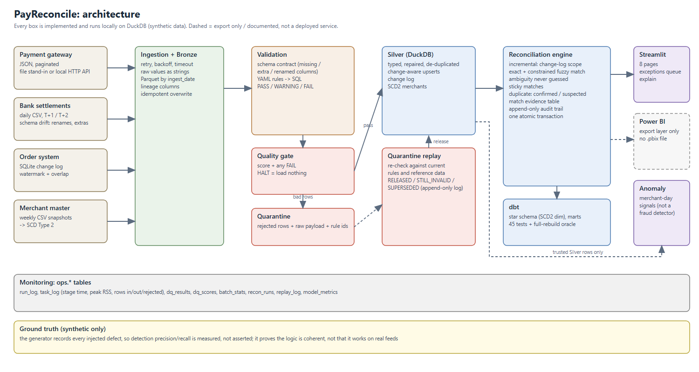

# Architecture and design decisions



Everything below is **implemented** and runs locally on DuckDB unless marked otherwise.

## Data flow

```
SOURCES (synthetic, messy)                     LOCAL STORAGE                        SERVING
gateway   JSON, paginated (files | HTTP API) -+
settlements  daily CSV                         +-> extract -> BRONZE  Parquet by ingest_date, all strings + lineage columns
orders    SQLite change log (watermark)        |     (retry, backoff, timeout)        |
merchants weekly CSV snapshots                -+                                      v
                                                                    SCHEMA CONTRACT  missing / extra / renamed columns
                                                                                      |  (missing required column = reject the file)
                                                                                      v
                                                                    DATA-QUALITY ENGINE  YAML -> DuckDB SQL, PASS/WARNING/FAIL
                                                                       |                       |
                                                              bad rows |                       | good rows
                                                                       v                       v
                                                                  QUARANTINE          batch checks: volume, freshness, distribution
                                                                  (raw payload,                |
                                                                   rule ids)                   v
                                                                       ^               QUALITY GATE  score + any FAIL -> PASS / WARN / HALT
                                                            replay ----+                       | HALT: nothing is loaded, Gold is not rebuilt
                                                                                               v
                                                                                     SILVER  typed, repaired, change-aware upserts
                                                                                               | (change log of every new/changed key)
                                                                                               v
                                                                        INCREMENTAL RECONCILIATION (Python + SQL, one transaction)
                                                                        fact_reconciliation, recon_links, recon_match_evidence, reconciliation_audit
                                                                                               |
                                               +-----------------------+-----------------------+
                                               v                       v                       v
                                       dbt: star schema,        Streamlit (8 pages)     anomaly signals (Silver only;
                                       marts, 45 tests          + Power BI export        blocked after a HALT)
```
Monitoring metadata for every stage (time, peak RSS, rows in/out/rejected) lands in `ops.*`.

## Layer contracts

| Layer | Contains | Never contains |
|---|---|---|
| Bronze | Raw values as received (strings) plus `_run_id`, `_source_file`, `_ingested_at`; overwritten per `ingest_date` | casts, cleaning, dropped rows |
| Quarantine | Rejected rows with `rule_ids` and the raw payload | anything also in Silver (except the second copy of a duplicate webhook) |
| Silver | Typed, repaired (`₹1,299.00` -> 1299.0, `dd/mm/YYYY` dates), de-duplicated rows | rows that failed an ERROR/CRITICAL rule |
| Reconciliation state | One row per item, links, per-match evidence, append-only audit | anything not derived from Silver and quarantine |
| Gold (dbt) | Star schema and marts read from Silver and the reconciliation state | untrusted rows |

## Ingestion: files and a local HTTP API
`ingest.GatewayClient` reads the seeded files (the deterministic test fixture). `gateway_api.py` (FastAPI, optional `[api]` extra) serves **the same records**: `GET /health`, `GET /transactions?date=&page=&page_size=` (1 to 2,000 per page, 422 on bad parameters). `ingest.HttpGatewayClient` follows `next_page`, applies a per-request **timeout**, retries transport errors, timeouts, HTTP 429 and 5xx with **exponential backoff** (capped; a server `Retry-After` is honoured but capped), and does **not** retry other 4xx or malformed payloads. Failures end as one `IngestError`, the run is recorded `FAILED`, and nothing is loaded. Fault injection (`--fail-first N`, `--delay S`) is deterministic. Tests prove the API path and the file path are interchangeable: running a day through one and then the other changes nothing in Silver. FastAPI was chosen because it was already installed as a Prefect dependency and gives validation for free; the API is a fixture, not a service claim.

## Reconciliation

1. **Exact pass:** normalised bank reference (`upper`, strip `GW-`) equals the gateway `txn_id`.
2. **Fuzzy pass** on what is left: same merchant, amount within tolerance, settled inside the SLA window, Levenshtein distance <= 2, and the pair is **unique from both sides**. Ambiguity is never guessed.
3. **Status per gateway movement:** `MATCHED`, `AMOUNT_MISMATCH`, `MISSING_SETTLEMENT` (none after the SLA), `PENDING` (not yet due), `ORPHAN_REFUND`.
4. **Settlement-side:** `ORPHAN_SETTLEMENT`, `SOURCE_QUARANTINED` (money moved for a gateway row we rejected: an upstream quality problem, not an orphan), `SETTLED_NOT_CAPTURED`. **Order-side:** `ORDER_WITHOUT_PAYMENT`, `PAYMENT_QUARANTINED`; per-payment flags `NO_ORDER`, `AMOUNT_DIFF`.
5. **Duplicate charges, two evidence tiers, never merged:**
   * *Confirmed (`TRUSTED_PAIR`)*: same order, merchant and amount, captured again within 10 minutes under a new `txn_id`.
   * *Suspected (`QUARANTINED_ORIGINAL`)*: one trusted payment plus a quarantined attempt on the same order that is a payment, not `failed`/`pending`, not contradicted by its own parseable amount or timestamp, and not a webhook copy of a trusted txn. It carries its own exposure column. A rule for quarantined originals **without** an order id was evaluated and **rejected** (no identifier anchor); see [investigation_misses.md](investigation_misses.md).
6. `money_at_risk` is defined per status ([kpi_definitions.md](kpi_definitions.md)); duplicate exposures are tracked separately.

### Explainability: `gold.recon_match_evidence`
For every exact link and every fuzzy **candidate** pair: `method`, `decision` (`LINKED` / `AMBIGUOUS_NOT_LINKED`), `edit_distance`, `amount_diff`, `days_gap`, `merchant_match`, `txn_candidates`, `settlement_candidates`, `score` (`1 - edit_distance / (max_edit_distance + 1)`), `threshold` (the constraint set), and a plain-English `reason`. The matcher is a constraint matcher plus a uniqueness rule; the score reports reference similarity and the decision is the uniqueness rule (stated in the table, not disguised as a probability). `explain` joins this with the audit history, Silver records, quarantine rows and the Bronze file.

### Incremental reconciliation (`src/payreconcile/reconcile.py`)
State: `gold.fact_reconciliation`, `gold.recon_links`, `gold.recon_match_evidence`, `gold.reconciliation_audit` (append-only), `ops.recon_state` (change-log watermark and as-of date), `ops.recon_runs` (scope and timing per run).

* **Change tracking:** Silver upserts touch only new or content-changed rows (`EXCEPT` over all business columns) and log each key to `ops.change_log`, including the *old* order id or bank reference of a replaced row. Quarantine changes are logged too.
* **Scope of a run:** items touched by a change, closed over dependencies (match partner, refunds that reference them, siblings on the same order, order items, quarantined-key dependants), plus `PENDING` items past the SLA and orders that just became old enough to judge, plus unmatched records that could fuzzy-compete with a scoped unmatched record. Already-linked records are never pulled in.
* **Sticky links:** a resolved link is re-examined only when one of its records changes. This keeps resolved matches stable at the price of a rare, documented difference from a from-scratch rebuild in ambiguous fuzzy cases.
* **Atomicity:** item delta, audit rows, link and evidence changes and the watermark are applied in one transaction. A crash leaves the previous state; a rerun redoes the same work.
* **Audit:** `NEW_ITEM`, `INPUT_CHANGE`, `AGED`, `RESOLVED`; `status_since` keeps the date a status last changed. `as_of` is the latest day ever loaded, so replaying an old day cannot rewind the clock.
* **Three implementations must agree:** the incremental state, the engine's own full mode (`reconcile --full`), and the separate dbt SQL in `dbt/models/reference`. `verify-recon --reference` and the end-to-end suite compare all three.

### Quarantine replay
`replay.py` re-evaluates a day's quarantined rows against current rules and reference data. Outcomes (all logged in `ops.replay_log`): `RELEASED` (loaded, then the incremental reconciliation runs), `STILL_INVALID` (rule ids refreshed, old and new logged), `SUPERSEDED` (a newer trusted version already exists: the stale copy is kept, re-labelled, never loaded). This last outcome exists because an earlier version of replay could overwrite a newer trusted row with an old quarantined copy; a regression test now covers it. Duplicate-webhook copies, schema rejects and superseded rows are never replayed.

## Decisions

| Decision | Why | Alternative not taken |
|---|---|---|
| DuckDB single file | analytical SQL (windows, `QUALIFY`, `levenshtein`, `EXCEPT`), near-zero idle memory; measured daily-run peak 380 MB | PostgreSQL: a server for no extra learning |
| Parquet for Bronze | columnar, typed on read, maps to object storage | CSV: no types |
| Custom YAML rule engine | every rule is readable SQL; row-level quarantine and a score are first class | Great Expectations: heavier, obscures the mechanics |
| dbt for marts/tests; Python + SQL engine for reconciliation | marts, tests and lineage suit dbt; scope closure, sticky links, an audit diff and one atomic apply are not expressible as a dbt incremental model. The dbt version is kept as the independent oracle | all-dbt incremental model |
| dbt as a subprocess | DuckDB allows one writer process; isolates dbt's global state | in-process runner (tried: it kept its own connection open and broke others) |
| Prefect (optional) | in-process, no server, retries and state | Airflow: scheduler + webserver + metadata DB is too heavy for 8 GB |
| Halt = load nothing | a half-loaded day is harder to reason about and replay | load valid rows anyway |
| Synthetic data with ground truth | detection quality is measured; no licensing questions | public data has no answer key |
| Suspected-duplicate tier separate from confirmed | keeps the confirmed count's precision meaningful | one merged, weaker flag |

### ADR: Silver stays in DuckDB tables (partitioned Parquet rejected)
**Question:** would date-partitioned Parquet reduce the cost of the incremental reconciliation? **Experiment:** same synthetic Silver history at 1x, 10x, 25x, 50x (both layouts) and 100x (table only), the unchanged engine reading Parquet through views, identical final state verified. **Result:** partitioned was 1.4x to 7.1x **slower** and scanned about 4-5x more rows; ingestion was faster (about 0.03 s vs 0.25 to 3 s) but is not the bottleneck and skips the change log. **Why (interpretation):** the engine looks up by key, so partition pruning never applies. **Decision:** keep tables. **Open item:** a date-bounded engine on the table layout might use min/max zone maps (a date-bounded lookup was 5 to 12x faster than an unbounded one in the micro-benchmark); it is **not built or measured**. Data: [benchmarks.md](benchmarks.md).

### Resource measurement
Every pipeline stage records wall-clock time, rows in/out/rejected and **peak RSS** (sampled every 50 ms across the process tree, so the dbt subprocess is included; a lower bound on the true peak) in `ops.task_log`. `scripts/report_stage_resources.py` summarises it.

## Gate semantics
`gate_decision` returns **HALT** if any dataset has a FAIL rule (missing required column, API outage yielding no rows, a 5x scale change, a stale file) or the overall score is below 0.90; **WARN** if there are warnings or the score is below 0.95; **PASS** otherwise. Score = severity-weighted mean of `1 - violations/evaluated` per rule, then a dataset-weighted mean (gateway and settlements 3, orders 2, merchants 1). **The score alone is not enough:** the paise-scaled demo batch scores 0.9988 because every row is individually valid; only the distribution rule stops it.

## ML: transaction anomaly signals
Merchant-day features from Silver gateway transactions; z-scores against each merchant's own previous days; Isolation Forest and a transparent rule baseline. Prediction time = end of the merchant-day; feature cutoff = previous days only; no labels, settlements or reconciliation status are read. The model refuses to refresh after a halted run. Not a fraud detector; synthetic anomalies only.
